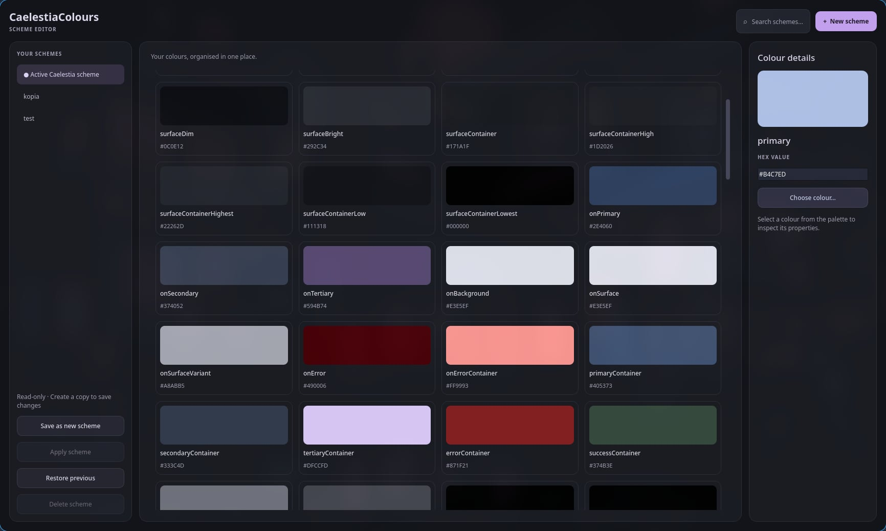
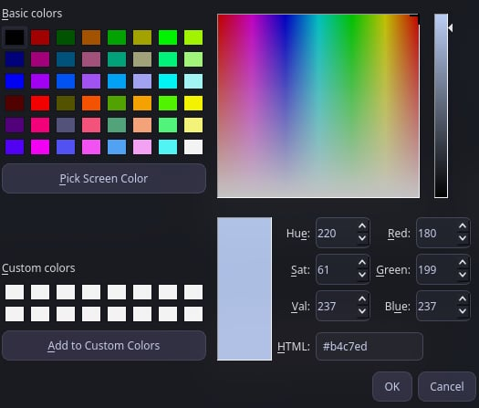

# CaelestiaColours

**A graphical colour scheme editor for Caelestia Shell on Hyprland.**

CaelestiaColours is a free and open-source desktop application written in **C++23 and Qt6 Widgets**. It provides a graphical interface for creating, editing, managing and applying custom colour schemes for [Caelestia Shell](https://github.com/caelestia-dots/shell).

Instead of manually editing JSON files, you can customise individual colours and manage multiple schemes from one interface.

**Current version:** v0.1.0

## Screenshots

### Main window



### Colour picker



## Features

- **Visual colour editor** — browse and edit individual colours using an interactive palette.
- **HEX colour editing** — enter precise colour values or use the graphical colour picker.
- **Custom schemes** — create, save and manage your own colour schemes.
- **Create from existing schemes** — duplicate the current palette, including unsaved colour changes.
- **Apply schemes** — activate a custom scheme in Caelestia Shell.
- **Restore previous scheme** — switch back to the previously active colour scheme.
- **Delete schemes** — remove custom schemes you no longer need.
- **Active scheme protection** — the currently active Caelestia scheme cannot be overwritten directly through the editor. To save modifications, create a new scheme.
- **Persistent storage** — custom schemes and backups are stored separately from Caelestia's active configuration.
- **XDG directory support** — respects `XDG_CONFIG_HOME` and `XDG_STATE_HOME`.

## Requirements

CaelestiaColours is designed specifically for **Hyprland users running Caelestia Shell**.

A working Caelestia Shell installation is required for applying and restoring colour schemes.

### Build dependencies

- Linux
- CMake 3.25 or newer
- A compiler supporting C++23
- Qt6 Widgets
- nlohmann/json 3.11 or newer
- Python with Caelestia's Python modules available

### Arch Linux / CachyOS

Install the build dependencies:

```bash
sudo pacman -S --needed base-devel cmake qt6-base nlohmann-json
```

Other Linux distributions may also work if Hyprland, Caelestia Shell and the required dependencies are correctly installed. However, they have not been tested.

**Note:** CaelestiaColours is not intended for standalone GNOME, KDE Plasma or other desktop environments without Caelestia Shell.

## Building from source

Clone the repository:

```bash
git clone https://github.com/Jerzy805/CaelestiaColours.git
cd CaelestiaColours
```

Configure the project:

```bash
cmake -S . -B build -DCMAKE_BUILD_TYPE=Release
```

Compile:

```bash
cmake --build build --parallel
```

The executable will be available at:

```text
build/caelestia_colours
```

Run the application directly:

```bash
./build/caelestia_colours
```

## Installation

### System-wide installation

After building the project:

```bash
sudo cmake --install build
```

By default, the application is installed to:

```text
/usr/local/bin/caelestia_colours
```

The desktop entry is installed to:

```text
/usr/local/share/applications/caelestia-colours.desktop
```

You can then launch CaelestiaColours from your application launcher or by running:

```bash
caelestia_colours
```

### User installation

To install the application without administrator privileges:

```bash
cmake --install build --prefix "$HOME/.local"
```

This installs the executable to:

```text
~/.local/bin/caelestia_colours
```

And the desktop entry to:

```text
~/.local/share/applications/caelestia-colours.desktop
```

Make sure `~/.local/bin` is included in your `PATH`.

If CaelestiaColours does not appear in the application launcher after installation, restart Caelestia Shell to refresh the application list:

```bash
caelestia shell --restart
```

## Usage

### Editing colours

1. Launch CaelestiaColours.
2. Select a scheme from the sidebar.
3. Click a colour card to open its details.
4. Enter a HEX value or choose a colour using the graphical picker.
5. Save your changes.

Colour changes are initially made in memory and are not automatically applied to Caelestia Shell.

### Creating a new scheme

1. Select an existing scheme, including the active Caelestia scheme.
2. Optionally modify its colours.
3. Click **New scheme**.
4. Enter a name for your new scheme.

The application creates a separate JSON file containing the currently displayed palette, including any unsaved changes.

### Editing the active Caelestia scheme

The active Caelestia scheme is protected against direct saving.

You can still edit its colours in memory to experiment with different palettes.

To preserve your modifications, use **Save as new scheme** to create a separate custom scheme.

This prevents accidental overwriting of the active configuration before applying a new scheme.

### Applying a scheme

1. Select a custom scheme from the sidebar.
2. Modify and save its colours if necessary.
3. Click **Apply scheme**.

CaelestiaColours saves the previously active scheme as a backup, replaces the active scheme file and requests a theme refresh through Caelestia's Python modules.

### Restoring the previous scheme

Click **Restore previous** to restore the previous active colour scheme.

The restore operation swaps the active scheme with its backup, allowing you to switch between the two states.

Only one previous active scheme is maintained by the built-in backup mechanism.

### Deleting a scheme

Select a custom scheme and click **Delete scheme**.

The application asks for confirmation before deleting its JSON file.

The active Caelestia scheme cannot be deleted through the application.

## File locations

CaelestiaColours follows the XDG Base Directory conventions.

| Purpose | Default location |
|---|---|
| Active Caelestia scheme | `~/.local/state/caelestia/scheme.json` |
| Custom colour schemes | `~/.config/caelestia-colours/schemes/` |
| Previous scheme backup | `~/.config/caelestia-colours/backups/previous.json` |

If `XDG_STATE_HOME` or `XDG_CONFIG_HOME` is set, the corresponding directories are used instead.

Custom schemes are stored independently from Caelestia's active scheme.

## Testing

The project includes backend tests covering scheme loading, modification, resetting, saving, reloading and invalid file handling.

Build and run the tests:

```bash
cmake -S . -B build -DCMAKE_BUILD_TYPE=Release
cmake --build build --parallel
ctest --test-dir build --output-on-failure
```

To build without tests:

```bash
cmake -S . -B build -DCMAKE_BUILD_TYPE=Release -DBUILD_TESTING=OFF
cmake --build build --parallel
```

## Known limitations

- CaelestiaColours is designed for Caelestia Shell on Hyprland and is not a general-purpose Linux theme editor.
- Applying and restoring schemes depends on Caelestia's Python modules being available to the `python` command.
- If the theme refresh fails, the scheme files may already have been updated. The operation does not automatically roll back changes caused before the refresh error.
- The application currently maintains a single previous-scheme backup rather than a complete history.
- Simultaneous modifications by multiple running instances are not supported.
- Automated tests currently focus on the scheme editor backend; GUI and live Caelestia integration are not covered by automated tests.

## Technology

- **Language:** C++23
- **GUI:** Qt6 Widgets
- **Build system:** CMake
- **JSON:** nlohmann/json
- **Filesystem:** C++ standard library
- **Target environment:** Linux, Hyprland and Caelestia Shell

## Contributing

Contributions are welcome!

If you would like to improve CaelestiaColours, you can fork the repository, implement changes and submit a pull request.

Bug reports, feature suggestions, code improvements and documentation contributions are appreciated.

Please keep contributions compatible with the project's **GPL-3.0-or-later** license.

## License

CaelestiaColours is free and open-source software licensed under the **GNU General Public License v3.0 or later (GPL-3.0-or-later)**.

You are free to use, study, modify and redistribute this software under the terms of the license.

Distributed derivative works must comply with the GPL's source-code availability and licensing requirements, ensuring that recipients retain the freedoms granted by the license.

See [LICENSE](LICENSE) for the full license text.

## Acknowledgements

CaelestiaColours is an independent project designed to work with [Caelestia Shell](https://github.com/caelestia-dots/shell).

It is not an official Caelestia Shell application.